<picture>
  <source media="(prefers-color-scheme: dark)" srcset="https://readme-typing-svg.demolab.com?font=Fira+Code&weight=600&size=26&duration=2800&pause=900&color=D2A8FF&center=true&vCenter=true&width=640&height=60&lines=Hey%2C+I%27m+AxD+%3E_;Turning+caffeine+into+commits;Feeding+my+commits+to+a+snake;sudo+make+me+a+sandwich" />
  
</picture>

<picture>
  <source media="(prefers-color-scheme: dark)" srcset="assets/terminal-dark.svg" />
  
</picture>

<picture>
  <source media="(prefers-color-scheme: dark)" srcset="https://raw.githubusercontent.com/AxD99999/AxD99999/output/github-snake-dark.svg" />
  
</picture>

Built with CSS, Python and questionable amounts of free time · no JavaScript was harmed

