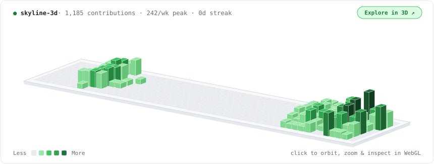

<picture>
  <source media="(prefers-color-scheme: dark)" srcset="assets/terminal-dark.svg" />
  
</picture>

 

<a href="https://axd99999.github.io/AxD99999/" title="Open interactive 3D contribution skyline">
  <picture>
    <source media="(prefers-color-scheme: dark)" srcset="assets/skyline-dark.svg" />
    
  </picture>
</a>

